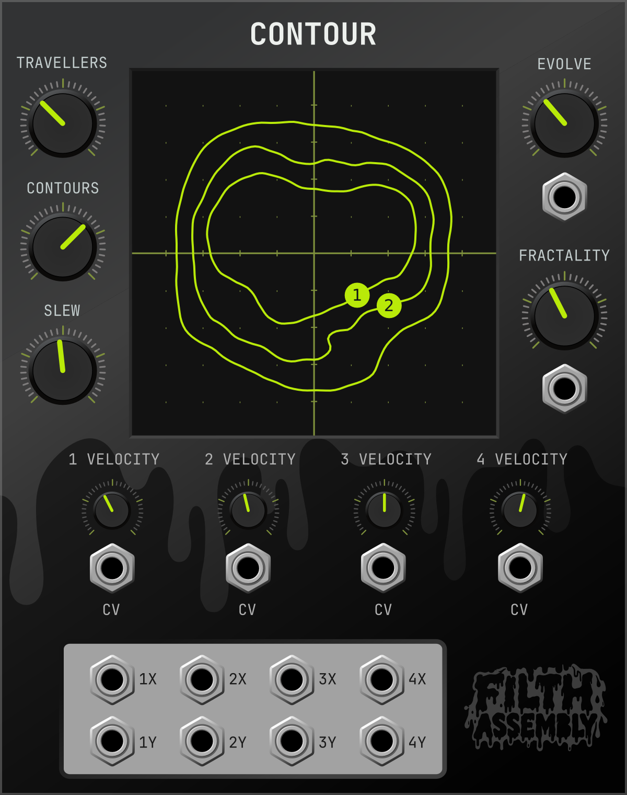
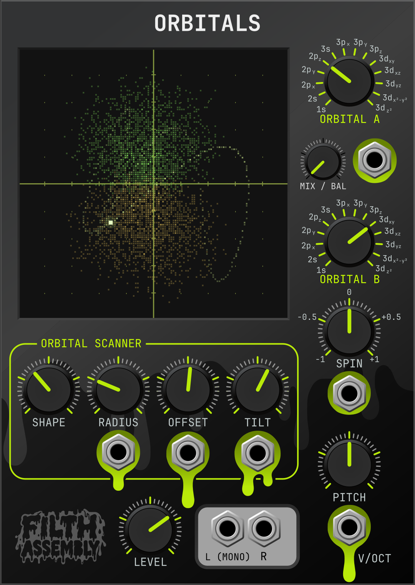

# Filth Assembly — VCV Rack modules

Development version **2.2.0-dev.4**, canonical plugin slug `FilthAssembly`,
brand **Filth Assembly**. This repository now builds **one plugin containing
Contour and Orbitals**. The migration is developed on `dev`; it is not a stable
release or a VCV Library submission.

## Contour

Contour is a 20 HP modulation source. Animated contour lines in a noise landscape
guide up to four travellers, each producing a pair of X/Y control voltages.
Use the evolving paths for filter, timbre, pan and other slow modulation.



[Contour manual](docs/Contour.md)

## Orbitals

Orbitals is an 18 HP oscillator that samples analytical hydrogen wavefunctions
along a three-dimensional path. Select and mix two orbital states, shape the
scan and watch the live dot-matrix field. L (MONO) provides an A/B mix; connecting
R switches to separate A/L and B/R audio with balance control. Quiet paths are
possible by design.



[Orbitals manual](docs/orbitals/README.md)

## Orbitals audio routing

For mono, connect only **L (MONO)** to your VCA or mixer. MIX / BAL retains the
previous equal-power A/B mix (including its identical-orbital special case),
levels and 5 ms coefficient smoothing.

For stereo, connect **L and R** to the left and right channels of a mixer or
another stereo destination. **An R cable activates stereo mode**, even if L is
unconnected. A goes only to L and B only to R. MIX / BAL becomes balance:
center gives both at normal level; turning left attenuates R/B, turning right
attenuates L/A. The endpoints leave only A/L or B/R. Gains never exceed unity.
With only R connected you hear B according to balance (silent at full left).
Cable changes take effect during processing without reloading the module.

MIX CV applies in both modes: +0.1/V, CV limited to ±10 V and the resulting
control clamped to 0…1. Stereo balance uses a continuous linear attenuation
curve with 5 ms smoothing. LEVEL and the existing ±5 V safety limit still apply.
The matrix display continues to show the A/B superposed field, not stereo meters.
Three DSP engines run continuously to preserve mono and keep channel phase/filter
histories ready during cable changes; this increases Orbitals CPU use.

## Build and test

Run these commands from `~/dev/vcv/Filth-Assembly-Modules` (or your clone of
[Filth-Assembly-Modules](https://github.com/villevaisanen/Filth-Assembly-Modules)).

Requires a C++11 compiler, GNU Make, Rack 2 SDK, jq, tar and zstd. The tested SDK
and runtime are Rack 2.6.6 on Linux x64. Override the default `~/Rack-SDK` as needed.
Python 3 is required for migration/audio checks; NumPy only for optional spectrum.

```sh
make -j4 RACK_DIR="$HOME/Rack-SDK"
make test RACK_DIR="$HOME/Rack-SDK"
make test-equivalence       # optional bit-exact Contour regression vs 2.1.2
make spectrum               # optional Orbitals spectral diagnostic (NumPy)
make dist                   # one FilthAssembly package with both modules
make test-package           # inspect packaged manifest/assets/license
make test-gui               # optional: installed Rack, display and OpenGL required
```

`make test` runs Contour core/small-stack and Rack worker tests, Orbitals
mathematical and concurrent visualization suites, actual combined-binary factory
and persistence checks, the historical audio regression, and preservation/asset
checks. `make test-core`, `make test-orbitals`, `make test-orbitals-visualization`,
`make test-audio-regression` and `make test-migration` can run without Rack SDK.
`make test-rack` needs the SDK and builds the combined plugin automatically.

All source, resources and historical audio-test fixtures are in this repository;
the standalone Orbitals repository is not a build or test dependency. Build outputs
are under `build/` and `dist/`. Assertions remain enabled in tests.

## Install a development build

Back up patches and close Rack before changing its plugin installation. Copy
`dist/FilthAssembly-2.2.0-dev.4-lin-x64.vcvplugin` into Rack's user-folder
`plugins-lin-x64` directory, or use `make install`. Restart Rack and search for
**Filth Assembly**: both **Contour** and **Orbitals** should appear.

Use **Help → Open user folder** in Rack to locate the folder. A combined package
replaces the standalone `FilthAssembly` package; two packages with the same plugin
slug cannot coexist. For development, prefer an isolated Rack user folder rather
than replacing your working installation. This task does not install globally.

## Development workflow and compatibility

Work on `dev`, keep commits reviewable, build and run tests before pushing.
Do not merge to the mainline (`master` in this repository), tag a stable release,
or submit to the VCV Library during this phase. Future modules are separate tasks.

Existing `FilthAssembly/Contour` patches retain their parameter, input, output,
seed and model identity. Orbitals retains
its ten parameter and six input IDs. Output ID 0 (formerly AUDIO) is now L (MONO);
ID 1 (formerly X) is now R. Former Y/Z output IDs 2/3 are removed.
Old X cables now carry B audio and activate stereo mode, changing L to A.
Y/Z cables cannot be preserved; remove/repatch old coordinate connections manually.
Full backward patch compatibility is not promised. Loading restarts its DSP
state as before; only Rack parameters are serialized.

Older `FilthAssemblyOrbital/ORBITAL` patches **are not automatically compatible**.
Back up and migrate their module identifiers to `FilthAssembly/Orbitals` and
remap input cables: FM/Sync were removed in the source's 2.1.2 worktree, and
remaining input IDs changed there before this migration. Earlier `Contour/Contour`
patches likewise need the plugin-slug correction documented in the Contour manual.

The [migration record](docs/migrations/001-orbitals.md) documents the source
commit, uncommitted source snapshot, files, licensing, changes and validation.
See [changelog](CHANGELOG.md), [Orbitals mathematics](docs/orbitals/MATHEMATICS.md)
and [historical Orbitals validation](docs/orbitals/VALIDATION.md).

## Validation

The Orbitals dev.4 visual changes and measurements are recorded in
[docs/validation-dev.4.md](docs/validation-dev.4.md). The combined-plugin dev.3
validation remains in [docs/validation-dev.3.md](docs/validation-dev.3.md).
Only Linux x64 with Rack SDK/runtime 2.6.6 is covered. Builds for other platforms,
subjective listening and CPU profiling with production patches remain separate
checks. Existing dev.2 routing and compatibility limitations above still apply.

The visually checked screenshots use the actual module widgets, DSP and Rack's OpenGL
renderer at the same 4× scale, with live display frames and no cables or menus.
Orbitals shows dev.4; the unchanged Contour image remains from dev.3.
Regenerate them with `make test-gui`, then convert the dark `*-theme-1.ppm`
files in `build/tests/` to PNG without scaling or altering their contents.

## License

Copyright © 2026 Ville Väisänen / Filth Assembly.

**GPL-3.0-only** for the combined source, documentation and artwork. The owner
explicitly authorized relicensing the imported Orbitals snapshot; historical
source licensing and the grant are recorded in [LICENSES.md](LICENSES.md).
The full license is [licence.txt](licence.txt).
