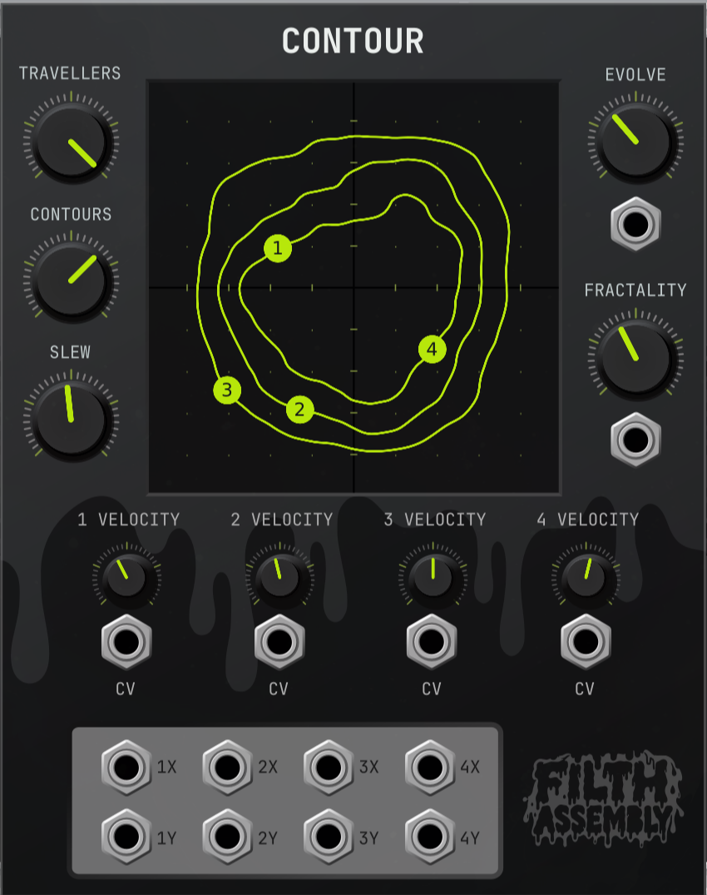

# Contour 2.1.3 — Filth Assembly

Contour is a 20 HP modulation module for VCV Rack 2. Animated contour lines
from a Perlin-noise landscape guide up to four independent balls. Each ball
provides a pair of X and Y control voltages, turning the movement on screen
into evolving modulation for your patch.



## Getting started

Add **Contour** by **Filth Assembly** from Rack's module browser. Connect a
ball's numbered **X** and **Y** outputs to parameters you want to modulate,
such as filter cutoff, oscillator timbre, panning, or effects. Start with the
default settings, then adjust **Velocity** for movement speed and **Evolve**
for how quickly the landscape changes.

For an XY display, connect an X/Y pair to the two inputs of a scope and
select its XY mode.

## Controls

| Control | Function |
| --- | --- |
| **Balls** | Sets the number of active balls, from 1 to 4. Default: 2. |
| **Contours** | Shows 1–4 contour levels. Each level can contain several loops. Default: 3. |
| **Evolve** | Sets the landscape's animation speed. Turn fully down to freeze it. Default: 35%. |
| **Fractality** | Adjusts the landscape's detail and complexity. Default: 40%. |
| **Slew** | Limits the speed at which balls join a new path. Higher settings make transitions faster. Default: 0.25 screen widths per second. |
| **Velocity 1–4** | Sets each ball's speed along its contour. Turn fully down to stop travel along the path. Defaults: 40%, 45%, 50%, and 55%. |

Evolve and Velocity use logarithmic speed ranges, with a small stop zone at
the bottom. Evolve ranges from 0.002 to 0.5 noise time units per second;
Velocity ranges from 0.005 to 2 screen widths per second. Slew ranges from
0.02 to 4 screen widths per second.

Balls follow closed loops counterclockwise in the internal XY coordinates.
Velocity controls distance travelled, so larger loops take longer to circle.
A ball with Velocity at zero can still move as its contour changes or while
joining a new path. Freezing Evolve stops landscape animation, but changing
Fractality still reshapes the landscape.

Slew controls transitions onto paths. Movement caused by a changing contour
can exceed this limit once a ball is following the path. A slow Slew setting
can leave a ball pursuing a moving path for an extended time.

## CV inputs and outputs

**Evolve**, **Fractality**, and all four **Velocity** controls have CV inputs.
The input is added to the knob setting: +5 V adds the full control range and
−5 V subtracts it, with the result clamped to the available range. Only the
first channel of a polyphonic input is used. Unconnected inputs contribute
0 V. Slew has no CV input.

Each ball has two monophonic outputs, **X** and **Y**, ranging from −5 V to
+5 V. Left and bottom are −5 V; right and top are +5 V. The center is 0 V
on both axes. The numbered balls show the positions used for these outputs,
including during transitions. Outputs update at audio rate.

## Paths and patch saving

Balls prefer separate loops. When all loops are occupied, balls can share
a path with different starting positions. A ball may move from a shared
path to a free loop. If a path disappears, its ball seeks another one; if
no paths are available, it holds its last position.

Newly activated balls start at the center and move onto a path at the Slew
speed. Reducing Balls removes the highest-numbered balls and fades their
outputs to 0 V over 10 ms.

Patches save the control settings and the landscape's random seed. Opening
a saved patch restarts movement using that seed; it does not resume the
previous positions or animation time. Reset generates a new seed.

## Installation

For a Linux x64 package, close Rack and copy
`Contour-2.1.3-lin-x64.vcvplugin` into the `plugins-lin-x64` directory inside
Rack's user folder. Use **Help → Open user folder** to locate it. Restart
Rack, open the module browser, and search for **Contour**.

## Building and testing

Build with a C++11 compiler, GNU Make, and the VCV Rack 2 SDK. The default
SDK path is `~/Rack-SDK`; override it with `RACK_DIR=/path/to/Rack-SDK`.
Packaging also requires `jq` and `zstd`.

```sh
make -j4 RACK_DIR="$HOME/Rack-SDK"
make test RACK_DIR="$HOME/Rack-SDK"
make dist RACK_DIR="$HOME/Rack-SDK"
```

`make test-core` runs the core tests and the 512 KiB stack regression without
Rack or its SDK. `make test-stack` runs only the stack regression, using
POSIX pthread stack attributes; unsupported platforms report a clear skip.
`make test-rack` requires the SDK and its Rack shared library and runs the
module, worker, port, persistence, and concurrent-instance checks without
a GUI. `make test` runs both groups. Assertions remain enabled in all tests.

The optional `make test-equivalence` compares terrain, motion, and CV results
bit for bit against release 2.1.2 for 768 terrains. It additionally requires
Python 3, Git, and repository history containing commit `6abab03`.
The build package is written to `dist/`; tests and build intermediates are
excluded from the installation package. `tests/Scope.vcv` is an example
patch requiring the VCV Fundamental plugin.

## License

Copyright © 2026 Ville Väisänen / Filth Assembly.

Contour's source code and artwork are licensed under the
GNU General Public License, version 3 only (GPL-3.0-only).
See [licence.txt](licence.txt) for the full license.
