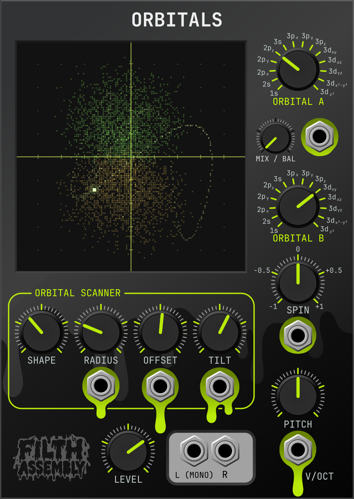

# Filth Assembly — Orbitals 2.2.0

A mono/stereo VCV Rack 2 oscillator sampling **signed, normalized analytical hydrogen wavefunctions** along a real-time three-dimensional path. Atomic units: Bohr radius $a_0=1$. Audio synthesis uses neither wavetables nor sampled spatial fields.

The path is a synthesis technique, not an electron trajectory. Pitch controls path traversal frequency; orbital symmetry may make the audible fundamental a multiple of that frequency. Cross-energy-level superpositions are static snapshots, without physical energy-dependent phase evolution.



## Play

Find **Filth Assembly / Orbitals** in the module browser. For mono, connect only L (MONO) through a VCA or mixer to your audio interface. Start at a low monitoring level. Defaults select 2p_z, radius 6 a₀, offset 1 a₀ and zero spin, giving a changing, audible signal. Connect a pitch source to V/OCT. Adjust RADIUS, OFFSET and SHAPE to explore the field. Selecting 1s can produce a stronger output than higher orbitals.

| Control | Range / behavior |
|---|---|
| Orbital A, B | Snapped 14-position selectors; right-click for state names |
| MIX / BAL | Mono: 0 = A, 1 = B; $\cos(\pi\,\mathrm{MIX}/2)$, $\sin(\pi\,\mathrm{MIX}/2)$ weights |
| PITCH | ±5 octaves around C4 = 261.625565 Hz |
| RADIUS | 0…24 a₀ |
| OFFSET | −24…24 a₀ on world X, after path tilt |
| SHAPE | Continuous axis amplitudes and phase offsets, fixed 1:2:3 harmonic ratios |
| TILT | ±180° rotation around path X |
| SPIN | Orbital frame rotation around Z, −0.5…+0.5 revolutions/s; zero stops |
| LEVEL | 0…100%, final linear gain |

States in order: 1s, 2s, 2p_x, 2p_y, 2p_z, 3s, 3p_x, 3p_y, 3p_z, 3d_xy, 3d_xz, 3d_yz, 3d_x²−y², 3d_z². In mono, identical A/B selections always have unit weight at every MIX setting.

| Input | Mapping |
|---|---|
| V/OCT | 1 V/octave, added to pitch |
| RADIUS CV | +2.4 a₀/V, total clamped to 0…24 |
| OFFSET CV | +2.4 a₀/V, total clamped to ±24 |
| MIX CV | +0.1/V, total clamped to 0…1 |
| TILT CV | +36°/V, total clamped to ±180° |
| SPIN CV | +0.05 revolutions/s/V, total clamped to ±0.5 |

All CVs are read each sample, using channel 1 only. Modulation CVs are limited to ±10 V before mapping. Nonfinite inputs become zero. Knob controls and the orbital coefficient vector use a 5 ms one-pole transition; MIX CV also goes through this transition. Geometry CV and V/OCT are unsmoothed. Fast external changes can therefore click. Orbital changes keep oscillator phase continuous and fade through the coefficient vector, including during repeated changes.

Each audio signal is DC-blocked at 5 Hz, uses one fixed gain of 40 V per atomic wavefunction unit before LEVEL, and is limited to ±5 V for safety. There is no AGC or per-state reweighting of the quantum superposition. Output level varies with the state and trajectory. Silent or almost constant paths are mathematically valid.

For stereo, connect L and R to the left and right channels of a mixer or another
stereo destination. An R cable activates stereo mode immediately, including
when only R is connected. A is routed only to L; B only to R. MIX / BAL becomes
a continuous linear balance: center is unity on both channels, left attenuates
B/R to zero, right attenuates A/L to zero. It never boosts either channel.
MIX CV uses the same mapping and clamp in both modes; stereo balance has 5 ms
smoothing. With only R connected, B is audible according to balance, and full
left is silent. Disconnecting R restores the original mono mix on L.

The updated light/dark panels label the audio outputs L (MONO) and R. Output ID 0 (AUDIO) becomes L;
ID 1 (X) becomes R; Y/Z IDs 2/3 are removed. Old X cables now carry audio and
activate stereo, changing L as well. Remove/repatch coordinate cables manually;
full backward patch compatibility is not promised. Parameter IDs (including MIX)
and input IDs and saved values are unchanged.

## Dot-matrix orbital monitor

The monitor is a **128 × 128 grainy dot matrix**. Its overlay has no opaque backing or decorative green border: the panel's original screen and coordinate grid remain visible beneath it. Green and muted amber dots show the positive and negative parts of the superposed orbital field; brightness comes from $|\Psi|^2$ with display-only exposure/gamma. A dotted path overlays the field, with a brighter recent trail and a glowing head. The oblique projection shows field rotation from SPIN and the path changes from RADIUS, OFFSET, SHAPE and TILT. A/B and MIX change the actual combined field, including interference and the identical-state special case.

In stereo the display still shows the superposed A/B field, not the separate channel levels.

The display receives the engine's effective, smoothed coefficients, CV-adjusted path, audio phase, spin phase and frequency at 30 snapshots/s. It does not read live audio-thread fields directly. A bounded lock-free single-producer/single-consumer queue drops snapshots when the UI stops. All field sampling and projection happen on the UI thread, at most 30 updates/s, using fixed arrays. The 24,576 spatial samples are deterministic; analytical field values are rebuilt only when the coefficients change enough. These UI samples never participate in audio synthesis. The spatial sampling law, field brightness mapping, cell size and path styling are unchanged from dev.3; the larger budget increases distinct visible cloud cells after projection and quantization. Cloud cells clear on every update; only the existing 180 ms trajectory trail persists. See [dev.4 measurements](../validation-dev.4.md) for paired counts and UI costs.

A 180 ms phosphor decay gives the head a short persistence trail. PITCH affects the real head phase and up to 2 ms of its recent path (capped at a quarter cycle). At audio frequencies the head is a **stroboscopic view**: apparent speed/direction can alias or stand still at display-rate multiples. This is not a slow-motion electron simulation. The cloud is a qualitative signed-density projection, with adaptive framing around the main lobes and full trajectory, and visual exposure rather than calibrated probability brightness. Rapid CV between snapshots is not captured. Browser previews show a deterministic default field without an audio module.

## Build and install in the combined repository

Requires the VCV Rack **2 SDK**, C++11 compiler, make, jq, tar and zstd. Default SDK location: `~/Rack-SDK`. Run the following from the repository root.

```sh
make -j4 RACK_DIR="$HOME/Rack-SDK"
make test
make test-rack
make test-orbitals-visualization        # includes concurrent snapshot transport tests
make test-audio-regression     # uses the vendored v2.1.0 fixture
make spectrum                 # optional; Python 3 + NumPy
make install                  # builds package and installs for the current user
```

Restart Rack after installation. Linux default plugin directory is `~/.local/share/Rack2/plugins-lin-x64/`. Override `RACK_USER_DIR` when using a custom Rack user folder. The distributable package is `dist/FilthAssembly-2.2.0-lin-x64.vcvplugin`. Other platforms require their own SDK build and are not validated here.

The panel is 18 HP and follows Rack's light/dark panel preference, including live
changes. Custom jacks use `res/orbitals/jack.svg`; knobs have a fixed `res/orbitals/knob_static.svg`
base and a rotating `res/orbitals/knob_top.svg`, with a smaller MIX knob. The 59 × 59 mm
screen frames the visible field and path together, with a 128 × 128 matrix.
Design sources are retained in `docs/orbitals/panel-sources/`. The authoritative
runtime artwork is in `res/orbitals/`, with text converted to paths for Rack's
NanoSVG renderer. The dev.3 L/R and LEVEL alignment corrections are applied to
the runtime SVGs; keep those positions when revising the design sources.

The plugin's visible name and brand are **Filth Assembly**. Its technical slug
is `FilthAssembly` (Rack slugs cannot contain spaces), and the module name and
slug are `Orbitals`: **FilthAssembly/Orbitals**. This replaces the prerelease
`FilthAssemblyOrbital/ORBITAL` identifiers. Old patches require migration and
FM/Sync cables must be removed; the remaining CV input IDs have changed.
Back up patches before migrating. The underlying synthesis engine is unchanged;
FM and Sync are no longer exposed by the Rack module.

## Implementation and validation

- `src/orbitals/dsp/HydrogenOrbitals.hpp`: analytical radial polynomials and real solid harmonics.
- `src/orbitals/dsp/Trajectory3D.hpp`: closed path, tilt and inverse field rotation.
- `src/orbitals/dsp/OrbitalEngine.hpp`: independent, allocation-free DSP; 4× sampling and a 95-tap Blackman-windowed sinc decimator.
- `src/orbitals/OrbitalModule.*`: Rack parameters, CV and sample-rate events.
- `src/orbitals/ui/OrbitalWidget.cpp`: custom SVG controls and themed panels.
- `tests/orbitals/`: analytical checks, independent volume integration, engine tests, binary loading and spectral diagnostics.

See [equations](MATHEMATICS.md) and [validation results and limitations](VALIDATION.md). Original design and placement reference are retained in this repository; the 2.1.2 implementation follows the newer task specification where it differs.

License of this imported version: **GPL-3.0-only**, authorized by the owner on 2026-11-09. The original standalone snapshot was proprietary. See [licensing and attribution](../../LICENSES.md). No GitHub Release is created by the build.

**Filth Assembly — Sound decisions.**
